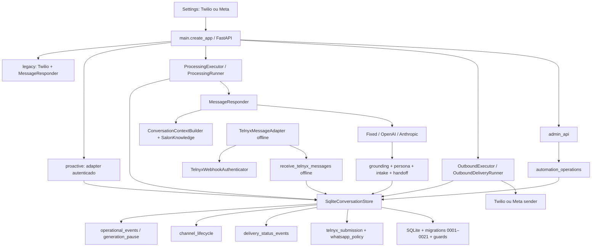

# Revisão independente A — arquitetura e regressão V1

Baseline de código inspecionada: `07c1b7dc150d7eb1776b97d891cd29347adffd37`.
Consulta: 20/11/2026, America/Sao_Paulo. Revisor: agente independente
`architecture_review`; leitura direta dos fontes, specs T01–10, ADRs 0010–0018,
spec V1 e instruções de evals. Relatórios de entrega não foram usados como prova
de implementação. Só este relatório e `INTERNAL-CONTRACT-MATRIX.md` foram escritos
por este revisor; nenhum código, teste, configuração, issue ou branch foi modificado.

## Parecer desta perspectiva

A fundação oferece fronteiras úteis para desenvolver o sender **offline**:
ingresso autenticado separado de observações, identidade persistida da entrega,
autorização com writer lock e resultado ambíguo não reenviável. Não identifiquei
novo P0/P1/P2 confirmado na revisão arquitetural. Isso não substitui as demais
perspectivas nem elimina CX-35: a chave e o fingerprint atuais não vinculam uma
requisição HTTP serializada, organização ou configuração efetiva do transporte.

O runtime não seleciona Telnyx. A composição, ativação verificada, consentimento
operacional, tratamento de formatos desconhecidos e workflow humano permanecem
incompletos. Esta perspectiva sustenta GO para evolução offline condicionada aos
gates do relatório consolidado e NO-GO para piloto/produção. Não houve envio real.

## Mapa de dependências realmente existentes



As setas para componentes offline representam chamadas possíveis pela API interna
e pelos testes, não uma ligação existente de `main.py` à Telnyx.

| Estado | Evidência direta | Consequência |
| --- | --- | --- |
| Runtime atual | `main.py:49–102`, `config.py:55`, `runtime.py:9–33` | Seleção de mensageria Twilio/Meta; geração fixed/OpenAI/Anthropic. |
| Webhooks atuais | `main.py:229–298` | GET Meta; POST Meta/Twilio/WhatsApp; nenhuma rota Telnyx. |
| Administração implementada | `main.py:180`, `admin_api.py:15–94` | API privada de consulta, pause/resume, sem UI/discovery de conversas. |
| Telnyx offline | `providers/telnyx_messages.py:91–177`, `webhook_ingress.py:11–41` | Assinatura/parser e commit antes de ACK disponíveis como componentes locais. |
| Telnyx desabilitada | `config.py:55–63`, `main.py:50–102` | Configuração de ingresso não torna o provider selecionável nem o canal pronto. |
| Contratos futuros representáveis | `whatsapp_policy.py:134–172`, `191–237` | Templates e política de resultados são classificadores, sem dispatch. |
| Ausente na baseline | Busca de chamadas e factory | Sender Telnyx, rota pública, ativação/rebinding, aquisição de consentimento e resolução de conflitos. |
| Intencionalmente postergado | ADRs 0017/0018 e specs T09/T10 | Epoch de ativação, HTTP/bytes, operação real e piloto dependem de outros gates. |

`main.py` é a composição root. `persistence.py` é a autoridade de transação e
possui 3.232 linhas: coordena Messages, outbox, claims, manutenção, contexto e as
novas side tables. Módulos menores recebem a conexão já aberta, mantendo os efeitos
na mesma transação. Isso dificulta revisão e amplia o custo de alterar SQL, mas
não é por si só defeito crítico nem justificativa para refatoração prévia ao sender.

O antigo `WhatsAppProvider` composto preserva o rollback síncrono; o novo
`InboundWebhookAdapter` e `OutboundMessageSender` têm papéis separados. O adapter
Telnyx implementa somente ingresso e não pode ser usado diretamente como renderer
legado. A diferença é intencional, não uma interface faltante a ser completada
fora do escopo.

## Matriz independente dos Tickets 01–10

“Conforme offline” significa conformidade dos caminhos inspecionados e dos limites
declarados; não significa contrato comercial validado ou prontidão operacional.
O conjunto de 403 testes executado por este revisor está discriminado abaixo;
testes apenas lidos nesta matriz não são apresentados como reexecutados por ele.

| Ticket / contrato normativo | Código implementador | Evidência específica inspecionada | Conformidade e saldo |
| --- | --- | --- | --- |
| T01: seis categorias, sem inferência por texto; spec01, sem ADR exclusivo | `domain.py:18–284`, `providers/base.py` | `test_classification_has_six_explicit_categories`, `test_unrecognized_inbound_subclass_is_not_silently_classified`, compatibilidade positional, evento operacional no runtime | Conforme classificador e adapters atuais. DTOs não autenticam. Store genérico tem aceitação mais ampla que o classificador; ver AR-02. |
| T02: journal separado, scoped dedupe, batch atômico; ADR0010 | `operational_events.py:44–99`, `persistence.py:523–614`, migration0014 | `test_conflicting_duplicate_rolls_back_prior_rows_in_batch`, `test_concurrent_duplicate_writers_commit_one_receipt`, `test_ack_only_after_successful_commit_without_generation` | Conforme offline. Aliases são observações e não fusão de identidade. Retenção ilimitada é CX-01, não solução de LGPD. |
| T03: pausa e revision fence da geração; ADR0011 | `generation_pause.py:6–93`, `persistence.py:2357–2661`, migration0015 | `test_pause_vs_completion_commit_race_has_two_explicit_orders`, `test_pause_during_llm_does_not_hold_sqlite_lock_or_persist_reply`, probe AR-01 | Saída cercada por owner/lease/revision e pausa. Custo de LLM já adquirido pode ocorrer após pausa; nenhum reply no probe. |
| T04: cancelar apenas não submetido; ADR0012 | migration0016; `persistence.py:1120–1207`, `delivery.py:47–138` | `test_manual_pause_fences_claimed_outbound_and_preserves_possible_submission`, testes de ordem pause/authorization e finalização/exhaustion | Conforme offline. Marker é possibilidade de submissão; autorização→HTTP continua CX-06. |
| T05: credencial própria, allowlist, CAS e replay; ADR0013 | `admin_api.py:18–92`, `automation_operations.py:44–122`, migration0017 | `test_concurrent_commands_have_single_cas_winner`, `test_resume_recovers_after_process_crash_or_lost_response`, `test_legacy_messages_keep_unresumed_behavior_but_require_source_time_after_resume` | Conforme contrato interno inspecionado. Replay retorna resposta histórica; GET lê estado atual. Resume não resolve unknown/handoff/canal. UI/TLS/gestão operacional continuam ausentes. |
| T06: autenticar bytes e escopo antes de interpretar; ADR0014 | `providers/telnyx.py`, `config.py:56–63` | `test_altered_body_fails_even_when_json_is_equivalent`, `test_authentication_precedes_any_json_inspection`, `test_telnyx_cannot_be_selected_in_runtime` | Componente offline. Chave real, clock, streaming e duplicação de raw headers não comprovados pelo runtime; CX-24/25. Revisão criptográfica pertence à perspectiva de segurança. |
| T07: origem/identidade/proveniência e ACK após commit; ADR0015 | `providers/telnyx_messages.py:107–177`, `inbound_events.py`, `webhook_ingress.py` | `test_hidden_phone_uses_opaque_namespace`, `test_purged_inbound_cannot_be_readmitted_by_replay`, `test_echo_during_llm_discards_result_without_holding_sqlite` | Conforme offline para formatos admitidos. Edits/revokes não geram novo input. Mídia/unknown rejeitados; futura política durável é CX-29. |
| T08: correlação scoped e evidência contraditória; ADR0016 | `delivery_status_events.py:23–154`, migration0019 | `test_early_late_order_restart_replay`, `test_reconciliation_failure_rolls_back_acceptance_and_link`, `test_purged_receipt_cannot_bind_to_reused_sqlite_ids` | Conforme política conservadora inspecionada. Delivered/read contradito mantém sucesso + conflict; não libera automação. Resolução operacional ausente, CX-32. |
| T09: binding único e ausência de active implícito; ADR0017 | `channel_lifecycle.py`, migration0020; claim/completion/authorization | `test_block_between_claim_and_llm_never_calls_generator`, `test_sql_replace_cannot_bypass_immutable_binding`, `test_restored_backup_retains_block_and_replay` | Conforme offline. Reconnect resulta verification_required; ausência de binding nega. Nenhuma ativação implementada, CX-33. |
| T10: janela/consentimento/key/fingerprint/attempts; ADR0018 | `whatsapp_policy.py`, `telnyx_submission.py`, migration0021, `persistence.py:1098–1207` | `test_exact_window_boundary`, `test_assessment_rechecks_revocation_before_authorization`, `test_concurrent_authorization_is_single_use`, histórico incompleto e prova retroativa em migration tests | Conforme contrato offline inspecionado. E.164 apenas. Sem request serializado nem prova operacional de consentimento/template. CX-35/36/37 permanecem gates. |

## Integração das invariantes

1. Ingresso Telnyx chama autenticador, parser, validação de escopo e journal/recibo
   na mesma cadeia; `require_message_provenance=True` é obrigatório na composição
   offline. A transação admite Messages e aplica pausa/lifecycle antes do retorno.
2. `ProcessingRunner` adquire trabalho durável; `MessageResponder` monta contexto
   e chama o gerador fora da transação. Completion compara owner, lease, revision,
   canal e handoff antes de inserir reply/outbox/intake. Nenhum token de owner
   autentica um operador.
3. `OutboundDeliveryRunner` transporta a mensagem da claim e a chave estável para
   `authorize_delivery_submission`. A avaliação Telnyx repete consentimento,
   janela, identidade, canal, conflitos e barreira de ordenação sob BEGIN IMMEDIATE.
4. O commit dos markers precede o sender. Pausa posterior preserva possibilidade
   de envio. Aceitação tardia é evidência; generic retryable depois do marker vira
   unknown para Telnyx. Crash/lease não cria permissão de retry.
5. Acceptance finaliza tentativa e reconcilia callbacks antecipados na mesma
   transação. Callbacks não criam outbox nem promovem unknown para pending.

Uma recusa de autorização após claim pode deixar `sending` até expirar e virar
unknown, mesmo sem marker. Isso está explicitamente testado em
`test_ineligible_runner_never_calls_sender_and_stale_claim_becomes_unknown`.
É uma escolha conservadora com custo de operabilidade, não evidência de envio nem
perda silenciosa: o bloqueio é durável. A política de aquisição/observabilidade
precisa ser considerada no sender/composição, sem adicionar retry por inferência.

## Inteligência V1 e regressões de infraestrutura

Comparação direta de `7495fb8e47482a2cba2958ef4bf4e6a210b6c018` (base T01)
com a baseline auditada: não há alteração de `grounding.py`, `livia_persona.py`,
`salon_knowledge.py`, `conversation_context.py`, `appointment_intake.py`,
`llm_decision.py`, `conversational_surface.py` ou adapters LLM. Em
`application.py`, a alteração é o gate de canal imediatamente antes da geração.
`main.py` acrescenta o router administrativo. `delivery.py` acrescenta passagem
da identidade e resolução de retry exhaustion no store.

| Fronteira V1 | Evidência de implementação | Resultado/limite |
| --- | --- | --- |
| Persona/transparência/naturalidade | `livia_persona.py:160–312`, testes de persona e agentic | Regras determinísticas preservadas. Naturalidade humana não é provada por pytest; CX-26 continua revisão de produto separada. |
| Grounding/fatos/preços/políticas | `grounding.py:32–259`, `salon_knowledge.py:79–114` | Fatos aprovados, referências, mandatory policies, validação da superfície e handoff permanecem fora do adapter. Não há consulta de disponibilidade nem booking. |
| Intents/comercial/intake | `application.py:203–278`, `appointment_intake.py`, testes agentic/commercial/intake | LLM propõe; finalizador e regras determinísticas autorizam ações; intake persiste com completion. Nenhuma mudança de modelo/prompt proposta aqui. |
| Histórico | `persistence.py:3088–3205`, `conversation_context.py:68–111` | Somente replies accepted/sent/delivered/read/accepted_legacy entram como fala da IA; pending/unknown/cancelled não. Inbounds suprimidos continuam histórico do Customer, coerente com retenção de mensagens recebidas. |
| Ordem e duplicatas | Unique reply/outbox, claims e barreiras em `persistence.py:2400–2434` | Unicidade local não equivale a exactly-once externo. Echo é observação sem body; não injeta fala humana no contexto. |
| Handoff/supressão | `persistence.py:2470–2661` e suite human_handoff | Completion/handoff/outbox/intake são atômicos. Resume operacional não libera handoff nem revive trabalho suprimido. |
| LLM em pausa/desconexão | `application.py:185–197`, completion guards | Resultado suprimido; chamada/custo já autorizados podem ocorrer. Ver AR-01 e CX-34. |
| Evals | `docs/evals/README.md`, harness e execução abaixo | Fixtures verificam orquestração/contratos; não medem qualidade probabilística, modelo real ou aceite humano. |

## Observações reproduzidas sem novo P1/P2

### AR-01 — P3: chamada LLM possível após pausa durante construção de contexto

Tipo: risco residual reproduzido, alinhado ao limite de custo da geração adquirida.
Código: `application.py:185–197`, `persistence.py:508–521`, `2470–2542`.

Ensaio próprio com SQLite temporário e gerador contador: admitir inbound sintético,
usar ProcessingRunner normal e envolver `_build_context` para aplicar um
`HumanMessageObserved` por outra conexão imediatamente antes de retornar contexto.
Resultado real:

```json
{"probe":"pause_before_llm_call","generator_calls":1,"processing_state":"suppressed","outbound_replies":0}
```

O gate pre-LLM verifica canal e não revalida owner/revision/pausa. A invariante de
não persistir resposta depois da pausa ficou protegida; não houve HTTP nem envio.
Impacto residual: custo/latência e envio de contexto ao LLM em trabalho adquirido
antes da pausa. Recomendação futura: avaliação explícita de revalidação do owner
antes do I/O, sem prometer eliminar a janela check→I/O. Teste proposto: pausa na
barreira de construção de contexto + contador de chamadas + ausência de reply.
Gate: política operacional/custo antes do piloto; não bloqueia o sender offline.

### AR-02 — P3: store genérico tem aceitação mais ampla que classificador

Tipo: inconsistência de fronteira interna reproduzida, sem bypass externo provado.
Código: `domain.py:241–267`, `persistence.py:534–540`, `inbound_events.py:82–90`.

Criar subclasse vazia de `InboundMessageReceived` com valores válidos. O
classificador rejeita o tipo desconhecido; `record_webhook_events((event,))`, sem
modo estrito, admite uma Message. Resultado:

```json
{"probe":"unknown_inbound_subclass","classifier":"rejected","store_admitted_rows":1,"boundary":"trusted internal generic store only"}
```

O caminho estrito Telnyx exige tipo exato e proveniência; adapters atuais emitem
tipos conhecidos. Isso não demonstra webhook forjado ou envio não autorizado.
Recomendação: documentar a compatibilidade do store genérico ou alinhar validação
quando houver necessidade real, com teste de subclasses nos dois modos.
Gate: manutenção de contratos; não bloqueia o sender offline.

### AR-03 — P3: concentração de SQL e invariantes

Tipo: dívida técnica, sem falha reproduzida. Código: `persistence.py`, migrations
0015–0021. Parte das mesmas invariantes aparece em queries, helpers e triggers.
O tamanho e a repetição aumentam o risco de drift em mudanças futuras. Revisar
alterações por matriz de gates e testes de caminhos alternativos é mais urgente
que refatorar. Gate: toda mudança de autorização; nenhuma refatoração nesta auditoria.

## Código sem uso comprovado e acoplamento

- `receive_telnyx_messages`, `assess_telnyx_submission`, `evaluate_template`,
  `idempotency_age` e `classify_submission_result` não têm consumidores no runtime
  atual; busca de chamadas encontrou o seam e testes. São contratos offline
  intencionais, não devem ser anunciados como operações habilitadas.
- `get_or_create_reply` continua API de compatibilidade com testes históricos;
  não encontrei chamada produtiva fora do próprio store. Não recomendo removê-la
  durante o sender nem atribuo severidade de segurança pela ausência de consumidor.
- O store importa regras Telnyx e helpers específicos, mas evita que o adapter
  controle transação ou faça rede dentro dela. O acoplamento é concreto e pequeno
  o suficiente para o estágio single-business, embora deva ser auditado a cada gate.
- O lifecycle possui uma única configuração Telnyx por banco. Vários números,
  organizações ou tenants não são suportados por esse modelo; não generalizar
  silenciosamente ao implementar o sender.

## Evidência executada por este revisor

Ambiente saneado via `env -i`; Python do `/tmp/audit-pre11-venv`; código baseline
inalterado; `PYTHONPATH=/tmp/pre11-network-guard:/workspace/rj-studio-ai/src`;
`PYTHONDONTWRITEBYTECODE=1`. Guard bloqueia conexões IP Python e filhos que
herdam esse ambiente. Nenhuma credencial comercial ou chamada de provider foi usada.

```bash
python -m pytest -q -p no:cacheprovider \
  tests/test_coexistence_contracts.py tests/test_generation_pause.py \
  tests/test_grounded_reply.py tests/test_livia_persona.py \
  tests/test_salon_knowledge.py tests/test_conversation_context.py \
  tests/test_handoff_authorization.py tests/test_human_handoff.py \
  tests/test_agentic_surface.py tests/test_appointment_intake.py \
  tests/test_commercial_steering.py tests/test_agentic_intake.py
```

Resultado: exit 0, **403 passed / 1 skipped**. `-q` somado ao addopts do projeto
suprimiu resumo e duração; contagem conferida nos progress markers do log
`/tmp/audit-pre11-architecture-tests.log`. Duração não capturada, não estimada.
Skip: fixture histórica não versionada em `test_historical_v8_record_remains_loadable`.
Não foi skip de contrato/provider; a ausência continua lacuna de reprodução.

Os dois probes acima foram executados por
`/tmp/pre11-arch-probes.py`, com `src` e `tests` no PYTHONPATH e o mesmo guard.
São reproduções locais, não testes acrescentados ao repositório. As etapas e
resultados estão descritos acima para continuação por outra conta.

Validação da suite de evals: `python -m rj_studio_ai.evaluation validate-suite`
retornou 53 casos, suite hash
`d7852901a10a8f175b69fa5632511fb54f53e65fecc6dd121290112dc9180631`, exit 0.
Dry-run independente executado com
`python -m rj_studio_ai.evaluation dry-run --repetitions 1 --output /tmp/audit-pre11-architecture-eval.json`:
exit 0, 53 casos, 23 replies completadas, **0/97 falhas críticas**; intent 14/14,
persona 6/6, grounding 31/31, handoff 48/48, context 21/21. Modo deterministic,
fixture-proposals-v1. Naturalidade permanece pending_human_review; latência/custo
permanecem pending_live. Esses números não provam qualidade de modelo real nem
latência WhatsApp. O record foi validado pelo comando `validate-record`.

## Gates para o sender

O próximo componente deve consumir a identidade persistida e a mesma autorização
one-shot; não pode inferir permissão a partir de um assessment anterior. Deve fixar
request/organização/bytes e política de retries do transporte; validar acceptance
e tratar timeout/resposta perdida/inválida como unknown sem reenvio automático.
Os testes do sender devem passar pelo runner e SQLite reais, incluindo callback
antecipado e pausa/lifecycle depois do marker. Esses requisitos concretizam CX-35
e preservam os limites de CX-06; sua implementação não ocorreu nesta revisão.

## Apêndice — reprodução copiável dos probes

Salvar o bloco abaixo em `/tmp/pre11-arch-probes.py` e executar na raiz da
baseline com o Python do venv, sem `.env` comercial:

```bash
env -i PATH=/tmp/audit-pre11-venv/bin:/usr/bin:/bin \
  PYTHONPATH=/tmp/pre11-network-guard:/workspace/rj-studio-ai/src:/workspace/rj-studio-ai/tests \
  PYTHONDONTWRITEBYTECODE=1 \
  /tmp/audit-pre11-venv/bin/python /tmp/pre11-arch-probes.py
```

O guard e venv são os descritos em TEST-EVIDENCE. Os probes usam somente
dados sintéticos, gerador fixo e SQLite temporário. A conexão usada por pause
é outra conexão ao mesmo arquivo; o interleaving é controlado pelo wrapper
de contexto. O script não altera os fontes nem afirma paralelismo simultâneo.

```python
import json
import sqlite3
from tempfile import TemporaryDirectory
from pathlib import Path

from rj_studio_ai.domain import InboundMessageReceived, classify_provider_event
from rj_studio_ai.generation import FixedReplyGenerator
from rj_studio_ai.persistence import SqliteConversationStore
from test_coexistence_contracts import inbound
from test_generation_pause import pause, runner


class CountingGenerator(FixedReplyGenerator):
    calls = 0

    def generate(self, *args, **kwargs):
        self.calls += 1
        return super().generate(*args, **kwargs)


class UnknownInbound(InboundMessageReceived):
    pass


with TemporaryDirectory(prefix="pre11-arch-") as directory:
    path = Path(directory) / "pause.db"
    store = SqliteConversationStore(path)
    store.initialize()
    store.record_webhook_events((inbound(),))
    generator = CountingGenerator("Synthetic reply")
    processing = runner(store, generator)
    original = processing.responder._build_context

    def context_then_pause(*args, **kwargs):
        context = original(*args, **kwargs)
        pause(SqliteConversationStore(path), now=None)
        return context

    processing.responder._build_context = context_then_pause
    processing.run_once()
    with sqlite3.connect(path) as connection:
        state = connection.execute("SELECT state FROM message_processing").fetchone()[0]
        replies = connection.execute("SELECT count(*) FROM messages WHERE direction='outbound'").fetchone()[0]
    print(json.dumps({"probe": "pause_before_llm_call", "generator_calls": generator.calls, "processing_state": state, "outbound_replies": replies}))

    path = Path(directory) / "subclass.db"
    store = SqliteConversationStore(path)
    store.initialize()
    sample = inbound()
    event = UnknownInbound(sample.provider, sample.provider_message_id, sample.customer_address, sample.recipient_address, sample.body, metadata=sample.metadata)
    try:
        classify_provider_event(event)
        classification = "accepted"
    except ValueError:
        classification = "rejected"
    store.record_webhook_events((event,))
    with sqlite3.connect(path) as connection:
        rows = connection.execute("SELECT count(*) FROM messages").fetchone()[0]
    print(json.dumps({"probe": "unknown_inbound_subclass", "classifier": classification, "store_admitted_rows": rows, "boundary": "trusted internal generic store only"}))
```
